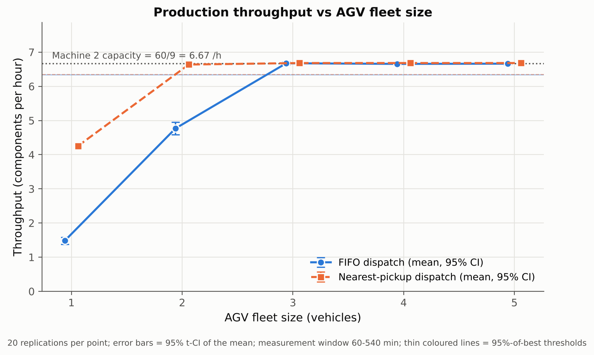
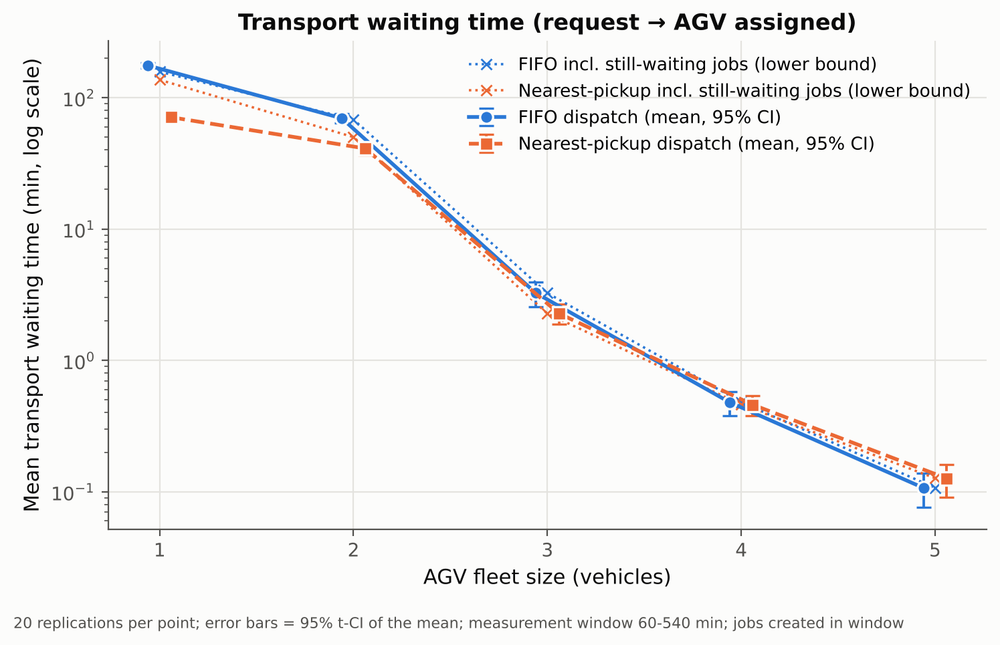
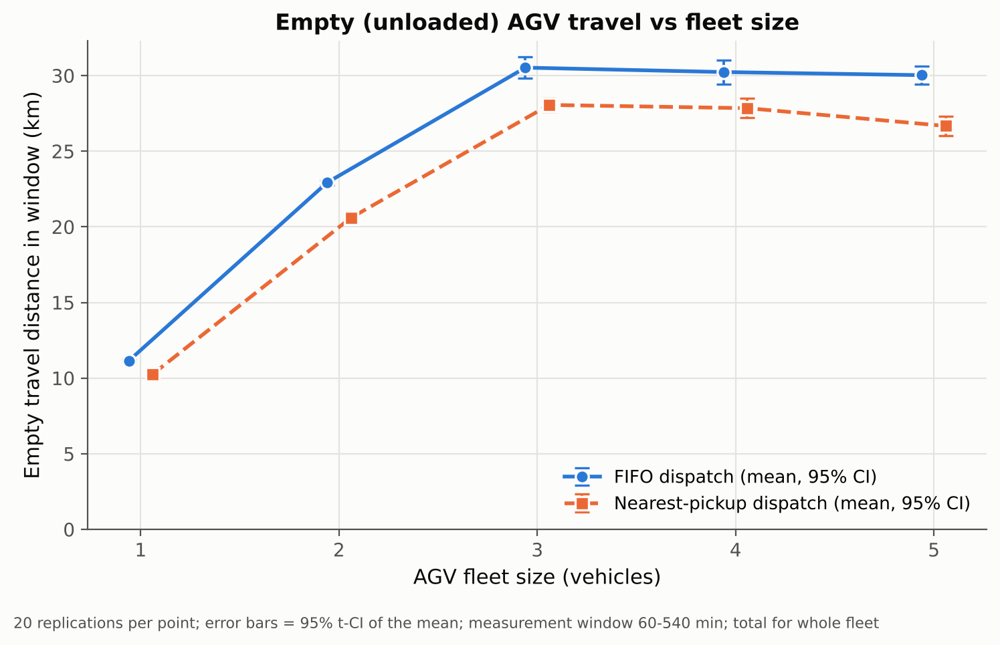
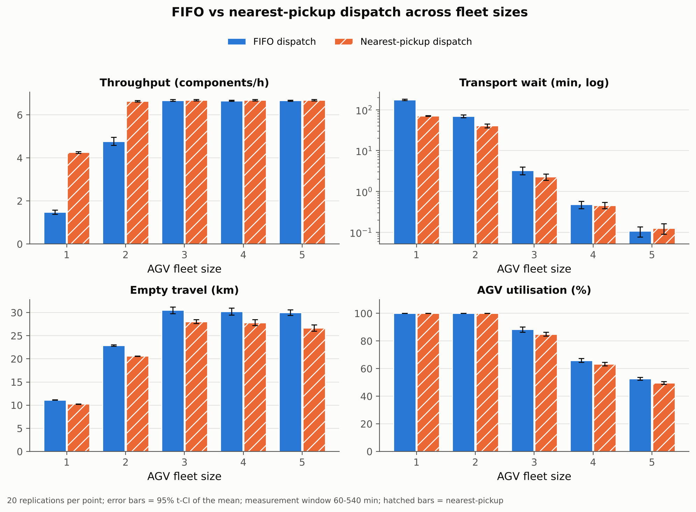

# Factory Material-Handling and AGV Fleet-Sizing Simulation

A discrete-event simulation (Python + SimPy) of a small four-station factory where Automated Guided Vehicles (AGVs) carry components between workstations.

The study asks two questions:

1. **How many AGVs are needed** to keep production throughput near its best achievable level?
2. **Which dispatch rule works better**: First-In-First-Out (FIFO) or nearest-pickup? The answer is given separately for each performance metric.

> **All input values are illustrative engineering assumptions, not measured industrial data.** The results describe this model, not a specific real factory.

---

## 1. Quick start

```bash
# 1) (optional) create a virtual environment
python -m venv .venv
# Windows:  .venv\Scripts\activate
# macOS/Linux:  source .venv/bin/activate

# 2) install dependencies
pip install -r requirements.txt

# 3) run the whole project (validation + 200 simulations + CSVs + figures)
python main.py

# 4) (optional) run the automated tests
python -m pytest -v
```

`python main.py` takes a few seconds and writes everything into `results/`. For a quicker trial, run `python main.py --replications 5`. Because the replications argument changes, the numbers will differ.

Tested with Python 3.13 and simpy 4.1.2, numpy 2.5.3, pandas 3.0.5, matplotlib 3.11.2, scipy 1.18.1. The project was also re-run with pandas 2.2 / numpy 2.1 / matplotlib 3.9 / scipy 1.14 / simpy 4.1.1. Those versions gave the same results, apart from floating-point rounding in the ninth decimal place.

---

## 2. Folder structure

```
agv_fleet_sim/
├── main.py              # entry point: checks -> experiment -> CSVs -> figures -> summary
├── simulation.py        # parameters, SimPy model, dispatch rules, metrics, invariant checks
├── analysis.py          # mean / std / 95% CI, fleet-sizing rule, paired comparison, plots
├── tests/
│   ├── conftest.py
│   └── test_simulation.py   # 23 automated tests (pytest)
├── requirements.txt
├── README.md            # this file
├── viva_notes.md        # interview / viva preparation
└── results/             # everything below is GENERATED by main.py
    ├── raw_replications.csv      # one row per simulation run (200 rows)
    ├── aggregated_results.csv    # mean, std, 95% CI per policy x fleet size
    ├── fleet_sizing.csv          # fleet-sizing decision per policy
    ├── paired_comparison.csv     # NEAREST minus FIFO, paired by seed, with 95% CI
    ├── analytic_checks.csv       # hand-calculated capacities
    ├── summary.txt               # human-readable results summary
    ├── validation_report.txt     # PASS/FAIL list of validation checks
    ├── fig1_throughput_vs_fleet.png
    ├── fig2_waiting_time_vs_fleet.png
    ├── fig3_empty_travel_vs_fleet.png
    └── fig4_policy_comparison.png
```

How the data flows: `main.py` writes `raw_replications.csv`, then **reads it back** to compute `aggregated_results.csv`. It then reads *that* file back to make the fleet-sizing decision and draw the figures. No result or plotted value is typed in by hand.

---

## 3. The factory model

```
 Raw Material Store ── Machine 1 ── Machine 2 ── Finished Goods Area
        0 m             100 m        200 m            300 m
```

Every component follows **RM → M1 → M2 → FG**. Each component therefore needs three transport jobs: RM→M1, M1→M2 and M2→FG.

### Assumptions (illustrative, not measured)

| Parameter | Value | Note |
|---|---|---|
| Fleet sizes tested | 1, 2, 3, 4, 5 AGVs | |
| AGV speed | 0.8 m/s (= 48 m/min) | constant, no acceleration |
| Interarrival time | Exponential, mean 4 min | the **only** random input (15 parts/h on average) |
| Machine 1 time | 7 min (fixed) | capacity 60/7 = 8.57 parts/h |
| Machine 2 time | 9 min (fixed) | capacity 60/9 = 6.67 parts/h → **bottleneck** |
| Pickup / drop-off | 0.25 min each per job | |
| Run length | 540 min | |
| Warm-up | 60 min (discarded) | |
| Measurement window | 60–540 min (480 min = 8 h) | |
| Replications | 20 per (policy, fleet size) | |
| Seeds | 42 + r for replication r = 0…19 | |

Modelling simplifications:

- One straight path with no collisions, blocking or traffic.
- No batteries, charging or breakdowns.
- Each AGV carries one part at a time.
- Machine and AGV-station buffers are unlimited.
- After a drop-off, the AGV waits where it is until it is dispatched again.
- All AGVs start idle at the Raw Material Store at time 0.

A component's machine is released as soon as machining finishes. The component then waits in that machine's output buffer for an AGV. **A component counts as completed only when it has been dropped off at the Finished Goods Area.**

---

## 4. What is discrete-event simulation, and why SimPy?

In a **discrete-event simulation (DES)**, the system state changes only at specific instants, called *events*. Examples are "a part arrives", "an AGV reaches Machine 1" or "Machine 2 finishes". Between events nothing changes, so the simulation clock **jumps** directly from one event to the next instead of ticking in small time steps. This makes DES exact for queueing systems like this one, and fast: 200 eight-hour shifts run in a few seconds.

**SimPy** is a free Python DES library. It is a good fit because its building blocks map directly onto factory concepts:

| SimPy concept | Where it is used here |
|---|---|
| **Environment** (`simpy.Environment`) | the simulation clock and event list |
| **Process** (a Python generator function) | `component()`: the life of one part. `arrivals()`: the part generator. `_agv_trip()`: one AGV doing one job |
| **Event / timeout** (`env.timeout(t)`) | "wait t minutes": machining, driving, pickup, drop-off |
| **Event you trigger yourself** (`env.event()`) | each transport job has a `done` event; the part waits on it, and the AGV triggers it after drop-off |
| **Resource** (`simpy.Resource(capacity=1)`) | Machine 1 and Machine 2: only one part at a time. Other parts wait in the resource's FIFO queue (the unlimited input buffer) |
| **Queue** | the dispatcher's `waiting_jobs` list (transport requests) and each machine's resource queue |

The AGVs are **not** a SimPy `Resource`, because a Resource always serves requests first-come-first-served. The nearest-pickup rule needs to look at *all* waiting jobs and *all* idle AGVs together. A small dispatcher function, `Factory.dispatch()`, does that pairing instead. It is called whenever a new job is posted or an AGV becomes free, so an AGV is never idle while a job is waiting.

---

## 5. The two dispatch rules

Both rules share exactly the same model, travel equations and metrics. The only code that differs is the selection function.

**Strategy A: FIFO** (`_select_fifo`)

- Job: the waiting job with the earliest creation time.
- AGV: the idle AGV that has been idle the longest (earliest `idle_since`).
- Ties are broken by lower job ID, then lower AGV ID.

**Strategy B: Nearest-pickup** (`_select_nearest`)

- For every (idle AGV, waiting job) pair, compute the empty distance `|x_AGV − x_pickup|`.
- Choose the pair with the smallest distance.
- Ties are broken by earlier job creation time, then lower AGV ID, then lower job ID. The job ID only fixes the rare case where two jobs were created at the same instant, so every choice is unique and reproducible.

Both rules are *greedy*: each decision looks only at the current moment. No optimisation, auctions or learning are used.

---

## 6. Equations

**Travel time** (speed `v` in m/s, distance `d` in m, result in minutes):

```
t_travel [min] = d [m] / (v [m/s] × 60 [s/min])
e.g. 100 m at 0.8 m/s → 100 / 48 = 2.083 min (125 s)
```

**One transport job** assigned at time `t_a`, with the AGV at position `x_AGV`:

```
d_empty  = |x_AGV − x_pickup|          d_loaded = |x_dest − x_pickup|
t_done   = t_a + d_empty/48 + 0.25 + d_loaded/48 + 0.25      (minutes)
busy interval of the AGV = [t_a, t_done]
```

Every loaded leg here is 100 m long, so it takes 2.083 + 0.5 = **2.583 min** including handling, plus any empty travel.

**Measurement window** `W = [T_w, T_end) = [60, 540) min`, with `|W| = 480 min = 8 h`.

**Throughput** (components per hour):

```
TH = (number of components dropped off at FG during W) / 8 h
```

**Transport waiting time** (request created → AGV assigned):

```
J_W   = transport jobs created during W that were assigned before T_end
W̄     = (1/|J_W|) × Σ_{j in J_W} (t_assigned,j − t_created,j)
```

Jobs still unassigned at `T_end` are **right-censored**: their true waiting time is unknown. They are reported separately as `jobs_unassigned_at_end`. A **lower bound** that includes them, counting their wait as at least `T_end − t_created`, is also reported. When the AGVs are overloaded, both numbers underestimate the true wait (see Section 9).

**Empty travel distance** (km, whole fleet). Speed is constant, so the distance covered inside W is speed × the time spent inside W:

```
D_empty = Σ_jobs  48 m/min × overlap([t_a, t_arrive_pickup], W) / 1000
```

**AGV fleet utilisation** (only the part of each busy interval that lies inside W counts):

```
U = Σ_jobs overlap([t_a, t_done], W)  /  (N_AGV × 480 min)
```

`overlap([s, e], [lo, hi]) = max(0, min(e, hi) − max(s, lo))`

Boundary handling:

- An activity that starts during warm-up is counted only from minute 60.
- An activity still running at minute 540 is counted only up to minute 540.
- All times of a job are deterministic once it is assigned, so they are known exactly even when the job finishes after the run ends.

**95% confidence interval for a mean** over n = 20 replications:

```
x̄ ± t_{0.975, n−1} × s / √n          with t_{0.975, 19} = 2.093
s = sample standard deviation (divide by n − 1)
```

This is valid because the replications are independent: each uses a different seed. Their means are approximately normally distributed.

**Fleet-sizing threshold** (applied separately for each policy):

```
TH_max = max over tested N of  mean TH(N)
N*     = smallest tested N with  mean TH(N) ≥ 0.95 × TH_max
```

This is relative to the **tested** fleet sizes (1–5), not to the true maximum capacity of a real factory. The code also checks whether throughput is still rising by more than 2% between the two largest fleets. If it is, the code reports that the tested range may be too small to show a plateau. If no fleet meets a threshold, the code reports "not reached" and does not crash.

**Paired comparison** (extra analysis). Replication r uses the same seed, and therefore exactly the same arrivals, for both policies. This lets the code compare the policies run by run: `d_r = X_r(NEAREST) − X_r(FIFO)`. It then builds a t-interval on the 20 differences. If the interval excludes 0, the difference is significant at 95%.

---

## 7. Validation performed

`main.py` runs these checks and writes them to `results/validation_report.txt`. All passed in the run that produced the results below.

- Travel time equation: 100 m → 2.083 min, 0 m → 0 min, negative distance rejected.
- Both policies complete a small (120 min, 2 AGV) simulation.
- Same seed → identical results. Different seeds → different arrivals.
- **After every one of the 200 replications**, `check_invariants()` checks:
  - every part follows the exact event sequence RM → M1 → M2 → FG, with times never going backwards;
  - each part's transport legs are RM→M1, M1→M2, M2→FG, in that order;
  - no AGV starts a job before finishing its previous one (one part at a time); a run-time check also stops the simulation if an AGV tries to pick up while loaded;
  - no machine processes two parts at once;
  - all travel and handling durations are non-negative and in order;
  - the drop-off time observed in the simulation equals the planned drop-off time;
  - the number of completed parts equals the number of finished M2→FG deliveries;
  - utilisation is within [0, 100]%;
  - total distance does not exceed what the fleet could physically drive;
  - completions do not exceed what Machine 2 can physically finish in the window.
- Arrivals are identical across policies and fleet sizes within a replication (common random numbers).

`tests/test_simulation.py` (23 pytest tests) additionally checks:

- the dispatch decisions on hand-built examples, including the tie-breaking rules;
- the CI formula against a hand calculation;
- the fleet-sizing edge cases: plateau reached, no plateau, threshold not reached, zero throughput;
- that a part which has finished Machine 2 but has **not** reached FG is *not* counted as completed;
- that the invariant checker really catches a deliberately planted machine-overlap error.

**Hand-calculation cross-check.** With 3 AGVs under FIFO, the simulation reports 24.66 km of loaded and 30.52 km of empty travel in 8 h. That is 64.2 + 79.5 = 143.7 min/h of driving. Add about 30.2 jobs/h (15 + 8.57 + 6.67) × 0.5 min handling = 15.1 min/h, for 158.8 min/h in total. Divided by the 180 AGV-minutes available per hour, that gives 88.2% utilisation. The simulation reports 88.4%. The small gap comes from averaging per-replication ratios.

---

## 8. Results (from `results/summary.txt`, 20 replications each)

Values are **mean [95% CI]**. Throughput is in components/h, wait in minutes, empty travel in km per 8-hour window. "Unassigned" is the mean number of transport jobs still waiting when the run ends.

| Policy | AGVs | Throughput | Transport wait | Empty travel | AGV utilisation | Unassigned |
|---|---|---|---|---|---|---|
| FIFO | 1 | 1.48 [1.38, 1.58] | 175.46 [167.92, 183.00] | 11.14 [11.07, 11.21] | 100.0% | 125.2 |
| FIFO | 2 | 4.77 [4.58, 4.96] | 69.61 [63.95, 75.27] | 22.92 [22.78, 23.07] | 100.0% | 62.4 |
| FIFO | 3 | 6.67 [6.63, 6.72] | 3.26 [2.56, 3.96] | 30.52 [29.81, 31.24] | 88.4% [86.5, 90.3] | 1.4 |
| FIFO | 4 | 6.66 [6.63, 6.68] | 0.48 [0.38, 0.58] | 30.23 [29.44, 31.02] | 66.0% [64.5, 67.5] | 0.4 |
| FIFO | 5 | 6.66 [6.63, 6.69] | 0.11 [0.08, 0.14] | 30.03 [29.42, 30.63] | 52.6% [51.7, 53.6] | 0.1 |
| Nearest | 1 | 4.26 [4.22, 4.29] | 70.87 [69.10, 72.63] | 10.25 [10.22, 10.29] | 100.0% | 101.2 |
| Nearest | 2 | 6.64 [6.61, 6.67] | 41.05 [36.66, 45.43] | 20.59 [20.55, 20.64] | 100.0% | 45.6 |
| Nearest | 3 | 6.68 [6.65, 6.71] | 2.28 [1.88, 2.67] | 28.06 [27.63, 28.49] | 84.9% [83.5, 86.3] | 1.1 |
| Nearest | 4 | 6.68 [6.65, 6.71] | 0.46 [0.38, 0.54] | 27.84 [27.20, 28.49] | 63.4% [62.1, 64.7] | 0.3 |
| Nearest | 5 | 6.68 [6.65, 6.71] | 0.13 [0.09, 0.16] | 26.67 [26.01, 27.32] | 49.7% [48.6, 50.8] | 0.1 |

### Fleet sizing (`results/fleet_sizing.csv`)

| Policy | Best mean throughput (tested) | 95% threshold | Minimum fleet N* | Plateau? |
|---|---|---|---|---|
| FIFO | 6.675 /h at 3 AGVs | 6.341 /h | **3 AGVs** | yes (+0.1% from 4→5) |
| Nearest-pickup | 6.681 /h at 3 AGVs* | 6.347 /h | **2 AGVs** (6.64 /h) | yes (0.0% from 4→5) |

\*3, 4 and 5 AGVs gave the same mean (6.681 /h). The code reports the smallest of the tied fleet sizes.

### Figures

| | |
|---|---|
|  |  |
|  |  |

### Paired comparison, NEAREST minus FIFO (`results/paired_comparison.csv`)

- **Throughput:** nearest-pickup is significantly higher at 1 AGV (+2.78 /h) and 2 AGVs (+1.87 /h). There is no significant difference at 3, 4 or 5 AGVs.
- **Empty travel:** nearest-pickup is significantly lower at **every** fleet size. The difference ranges from −0.89 km at 1 AGV to −3.36 km at 5 AGVs, which is 8% at 1 AGV and 11% at 5 AGVs.
- **Transport wait:**
  - Nearest-pickup is significantly lower at 1–3 AGVs.
  - There is no significant difference at 4 AGVs.
  - At 5 AGVs, nearest-pickup is significantly **higher**, but only by +0.019 min (about 1 second). That difference is statistically detectable but has no practical importance.
- **AGV utilisation:**
  - Identical at 1–2 AGVs, where both rules keep the AGVs busy 100% of the time.
  - Significantly lower for nearest-pickup at 3–5 AGVs (−2.6 to −3.5 percentage points), because it spends less time driving empty.

---

## 9. Interpretation

### The bottleneck

Machine capacities are M1 = 60/7 = 8.57 /h and M2 = 60/9 = 6.67 /h, so **Machine 2 is the bottleneck**. Parts arrive at 15 /h, which is 2.25 times what M2 can handle. **This factory is overloaded by design.** No number of AGVs can raise throughput above about 6.67 /h, and with enough AGVs every policy reaches that ceiling. M2 utilisation is 100% for all cases with ≥ 2 AGVs except FIFO with 2 AGVs, where it is 95%.

The observed mean can be slightly above 6.67 (for example 6.68). The 480-minute window can contain up to ⌊480/9⌋ + 1 = 54 completions (6.75 /h), because M2 may already be part-way through a job when the window opens.

Because arrivals exceed capacity, work-in-progress grows throughout the run. With ≥ 3 AGVs, about 83 parts are in the system at minute 540: roughly 61 queued at M1 and 16 at M2. **There is no steady state.** Queue lengths depend on run length, and the 60-minute warm-up only removes the empty-start transient. Throughput is still a stable measure, because it is set by a saturated bottleneck. This is an important limitation of the chosen input values (see Section 10).

### Why more AGVs help, then stop helping (diminishing returns)

With too few AGVs, transport itself becomes the bottleneck. The AGVs are busy 100% of the time and parts wait hours for a vehicle.

Here is the rough workload estimate. Every arriving part is eventually carried to M1 (15 /h), M1 feeds M2 at up to 8.57 /h, and M2 releases 6.67 /h. Each loaded leg takes 2.58 min, so (15 + 8.57 + 6.67) × 2.58 ≈ 78 AGV-min per hour is spent driving loaded and handling parts. Empty travel adds about as much again: the simulated empty-to-loaded distance ratio is about 1.1–1.25 with ≥ 3 AGVs. That is roughly 150–160 AGV-min per hour of work, or about 2.5–2.7 vehicles' worth.

Once there are enough AGVs to keep M2 always supplied, extra AGVs only shorten transport waits, from 3.3 min to 0.1 min under FIFO. Throughput does not change, and utilisation falls (88% → 53% for FIFO). That is the diminishing return: the 4th and 5th AGVs buy shorter waits, not more output.

### Why nearest-pickup needs fewer AGVs here, and its hidden cost

With 1–2 AGVs, nearest-pickup gives much more output than FIFO. After dropping a part at M1 or M2, the closest job is usually the one at the AGV's current station: zero empty distance. So the rule keeps serving the *downstream* legs, M1→M2 and M2→FG. Those are the moves that turn work into finished goods.

FIFO treats all jobs alike. Most waiting jobs are RM→M1 moves, because parts arrive at 15 /h, so FIFO spends most of its scarce AGV time pushing more raw material into the M1 queue.

The cost of nearest-pickup is **unfairness / starvation**:

| AGVs | Leg | FIFO mean wait | Nearest mean wait |
|---|---|---|---|
| 1 | RM → M1 | 176 min | **263 min** |
| 1 | M1 → M2 | 177 min | 3 min |
| 1 | M2 → FG | 172 min | 5 min |
| 2 | RM → M1 | 70 min | **99 min** |
| 2 | M1 → M2 | 70 min | 2.5 min |
| 2 | M2 → FG | 70 min | 3.9 min |

In this overloaded factory, leaving raw parts in the store costs no output, because M2 could not process them anyway. That is why nearest-pickup reaches the throughput target with 2 AGVs. **This conclusion depends on the arrival rate exceeding the bottleneck capacity.** In a factory where every raw part matters, or where raw parts have a due date, the long RM waits could be unacceptable. With 2 AGVs, about 46 jobs are still unassigned at the end of the run.

### Why one rule can improve one metric and worsen another

The rules optimise different things. Nearest-pickup minimises *empty distance per decision*, which also lowers utilisation and the overall average wait at small fleets. But it ignores *how long* a job has waited, so the far-away jobs can wait far longer.

FIFO is fair in waiting time but drives further empty. At 5 AGVs, FIFO's average wait is about 1 second shorter, a statistically significant but negligible difference.

Note the censoring effect at small fleets. The mean wait counts only jobs that were assigned before the end. Jobs never assigned are excluded, so the averages for 1–2 AGVs underestimate the true wait. Compare with the lower-bound column (`mean_transport_wait_lower_bound_min`) and the unassigned count.

---

## 10. Limitations (what makes this simpler than a real factory)

- **Input values are assumptions**, not measurements. Arrivals exceed the bottleneck capacity, so the system never reaches steady state and WIP grows without limit. A real plant would control material release, for example with CONWIP or kanban.
- Single straight bidirectional path with no traffic, collisions, blocking, passing rules or turns. Speed is constant, with no acceleration.
- No battery, charging, breakdowns, maintenance or human interference.
- Unlimited buffers. A real machine has a finite input/output space, which would block the upstream station.
- Deterministic machine times, with no setups, scrap or rework.
- The dispatch rules are greedy and myopic. Idle AGVs stay where they dropped off; they are not repositioned.
- Only one shift (8 h measured) is simulated per replication. Only fleet sizes 1–5 and one layout are tested.
- Throughput CIs assume independent replications. The mean ± t-interval is approximate for small n.

## 11. How the model could be validated against a real factory (future work)

1. **Collect input data:**
   - time-stamped part arrivals (fit a distribution and test the fit, e.g. with a chi-square or Kolmogorov–Smirnov test);
   - measured machine cycle times, including their variability;
   - AGV speed, acceleration and handling times from the AGV controller logs;
   - the real route distances.
2. **Face validation:** walk process experts through the event trace to confirm the logic (route, dispatch behaviour, buffer rules).
3. **Results validation:** run the model with the plant's real fleet size and dispatch rule. Compare simulated throughput, transport waits and AGV utilisation with plant records over the same period, using confidence intervals or a hypothesis test.
4. Only after this calibration use the model for what-if questions. Examples:
   - lower arrival rates (e.g. mean interarrival 10 min, below the bottleneck capacity);
   - a release-control rule;
   - battery charging;
   - an anti-starvation rule such as "nearest, unless a job has waited > X min".

## 12. Changing parameters

All inputs live in the `Params` dataclass at the top of `simulation.py`. Edit a default value and rerun `python main.py`; all CSVs and figures are regenerated. Keep a copy of the original `results/` folder if you want to compare scenarios.
